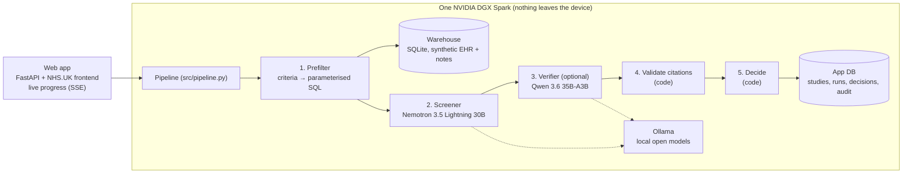

# Advolare

**Finds patients for clinical trials from hospital records, on one NVIDIA DGX Spark, without patient data leaving the site.**

NVIDIA Hack for Impact, Sheffield, 13 November 2026, Public Services track.

> All patient data in this repository is synthetic, and every study sponsor and ethics reference is fictional.
> Advolare is a hackathon prototype. It is not an NHS product and is not endorsed by the NHS.

## The problem

Trials fail or run late because research teams cannot find eligible patients in time. Today a research nurse reads
record after record by hand to check each inclusion and exclusion criterion. Much of the evidence is in free-text
clinical notes, which databases cannot query, and sending those notes to a cloud AI service is not acceptable for
patient data.

## What Advolare does

A clinician enters a study and its criteria. Advolare then screens the hospital's records in five steps and
shows every patient with the evidence for each criterion. The clinician makes every decision.

1. **Prefilter (code).** Structured criteria (age, CURB-65, eGFR, diagnosis codes, current admission) are compiled into a
   parameterised SQL query over the data warehouse. The model never writes SQL.
2. **Screen (local Nemotron).** For each candidate, the model reads the clinical notes against each notes criterion and
   answers met, not met or insufficient, with exact quotes from the record as citations.
3. **Verify (optional second model).** Qwen can independently re-check shortlisted patients. It is off for the demo.
4. **Validate (code).** Every quote is checked against the cited record. A quote that is not there is flagged, never hidden.
5. **Decide (code).** Code, not the model, combines verdicts and flags into *likely eligible*, *excluded* or *needs review*.

**It never guesses.** Missing evidence, a failed quote, a model error or a disagreement sends the patient to human
review. An exclusion counts as "not mentioned" only when the model was shown every note and found nothing, and the
patient page says so.

## Architecture



## Runs on one DGX Spark

- Both models are open weights served locally by Ollama on the Spark's GPU. No cloud API is called.
- Patient contact details (`PatientContacts`) never go to a model. They are shown only after a clinician approves a patient.
- Saved runs, decisions and the audit trail live in an app database on the Spark and survive redeploys.

## Features

- **Live screening progress.** Each step streams to the page as it runs.
- **Evidence per criterion.** The quote, the record it came from, and whether the quote checked out.
- **Do-not-contact filter.** Patients who opted out are removed by code before any model reads their records.
- **Draft criteria from free text.** Write the criteria in plain English, then review the structured draft.
- **Fairness check.** Compares the shortlisted patients with a reference population by age band, sex and ethnic group.
- **What if.** Shows how many more patients would qualify if one criterion were dropped, reusing the saved verdicts.
- **Screening log.** A CSV of every patient's outcome and the clinician's decision.
- **Invitation letter.** A draft letter after approval, with no condition named. Advolare never sends it.
- **FHIR export.** The study and its criteria as a FHIR R5 ResearchStudy and Group, with illustrative SNOMED CT codes.

## Making it fast on one GPU

- **Parallel work.** Several patients at once, and each patient's criteria in parallel. Ollama serves 8 requests at a time per model.
- **Reasoning off.** Thinking is off by default (`reasoning_effort: none`). It is about 30 times slower on a short check and did not help these yes/no answers.
- **Notes in the prompt.** The patient's notes go straight into the first message, so each criterion is one model call, not a multi-step tool loop.
- **Throughput.** About 80 to 90 tokens per second per model on the Spark when idle.
- **Pre-extracted facts (built in, off).** `ADVOLARE_FACTS=on` reads facts that Nemotron extracted once per note at ingest (`data/extract_facts.py`), so screening needs almost no model calls. It is off for the demo so screening is live.

## Run it

On a machine with Docker and an Ollama server holding the two models:

```
cd deploy
LANIP=<this machine's LAN IP> docker compose --profile web up -d --build
```

Then open `http://<host>:8000`. The image builds the synthetic warehouse (`data/generate.py`) and loads the clinical
notes (`data/load_notes.py`) at build time. Settings are environment variables, listed in `api/README.md`. For example,
`ADVOLARE_MOCK=true` gives canned results without a GPU, and `ADVOLARE_VERIFIER=on` turns on the second model.

For local development:

```
pip install -r requirements.txt
python data/generate.py && python data/load_notes.py
ADVOLARE_MOCK=true uvicorn api.main:app --reload --port 8000
pytest -q
```

**CI/CD.** A self-hosted GitHub Actions runner on the Spark (`.github/workflows/deploy-spark.yml`) redeploys
the stack on every push to `master`, using `deploy/deploy.sh`.

## Repository

| Path | What it is |
|---|---|
| `api/` | FastAPI app: pages, JSON API, live progress, extras |
| `web/` | HTML and vanilla JavaScript pages using the NHS.UK frontend |
| `src/prefilter.py` | Structured criteria → parameterised SQL |
| `src/screening.py`, `src/llm.py`, `src/tools.py` | Model screening, the LLM gateway and the read-only record tools |
| `src/validation.py` | Citation checks |
| `src/decide.py` | The final decision, made by code |
| `src/pipeline.py` | Runs the five steps and reports progress |
| `data/` | Synthetic warehouse generator, notes loader, demo studies |
| `deploy/` | Docker Compose, deploy script, self-hosted runner setup |
| `AGENTS.md` | The team's design rules |

## Team

Harkaran, Saif, Piyush and Frank.

## Next steps

- **vLLM with NVFP4** weights on the Spark, for higher throughput.
- **Scale up to H100s** for a whole hospital's records and many studies at once.
- **A vector index over the notes**, so the model reads only the relevant passages of long records.
